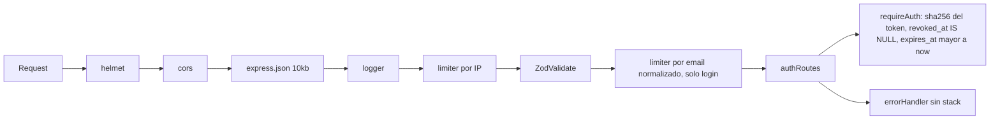

# Fase 1: Backend de autenticación

Las tablas de diseño están en el chat. Estas son las decisiones confirmadas:

- Si el email ya existe, el registro responde **409 EMAIL_TAKEN**, con rate limit por IP en `/auth/register`: 30 por hora por defecto en dev y 5 por hora como valor de producción documentado.
- El registro devuelve **201 `{ user }` sin token**; mobile llama después a `/auth/login`.
- **TypeScript** con `tsx` para dev y `tsc` para tipado. `type: module`, `engines.node` `>=24` y `.nvmrc` con `24`.
- Todos los límites de rate limit salen de variables de entorno, validadas en `config.ts` con defaults. El store es en memoria: reiniciar el servidor resetea los contadores (documentado en `.env.example`).
- El limiter de login por email corre **después de Zod**, con el email normalizado como clave, y cuenta los intentos fallidos aunque el email no exista. Así el 429 no revela si la cuenta existe.
- `GET /auth/me` devuelve `{ user, session: { expiresAt } }`.
- Argon2: `algorithm: Argon2id` explícito, `memoryCost: 19456`, `timeCost: 2`, `parallelism: 1`. El hash dummy usa los mismos parámetros.
- Al arrancar: `DELETE FROM sessions WHERE expires_at <= now`.
- `connection.ts` crea la carpeta de `DATABASE_PATH` si no existe (`fs.mkdirSync(..., { recursive: true })`), salvo para `:memory:`.

## Flujo de una request

## Variables de entorno nuevas (`.env.example`)
- `CORS_ORIGINS`
- `RATE_LIMIT_GLOBAL_PER_15MIN=300`
- `RATE_LIMIT_REGISTER_PER_HOUR=30` (en producción: 5)
- `RATE_LIMIT_LOGIN_IP_PER_15MIN=10`
- `RATE_LIMIT_LOGIN_EMAIL_PER_15MIN=5`

## Orden de implementación
1. Scaffold: `npm install --save-exact`, reportar el resultado real de `better-sqlite3` en Node 24.22, `tsconfig.json`, `vitest.config.ts`, scripts, `engines`, `.nvmrc` y `.env.example`.
2. BD: [backend/migrations/001_init.sql](backend/migrations/001_init.sql), `src/db/connection.ts` (crea la carpeta) y `src/db/migrate.ts`.
3. Núcleo de auth: `password.ts`, `sessions.ts` (con `deleteExpiredSessions`), `users.ts` y `auth.schemas.ts`.
4. Middlewares, `app.ts` y `server.ts` (migraciones, limpieza de sesiones vencidas y `listen`).
5. Rutas: los 4 endpoints.
6. Tests, incluido persistencia con archivo temporal y token revocado devuelve 401. Correrlos y reportar el resultado real.
7. Completar la fila de la Fase 1 en [AI_USAGE.md](AI_USAGE.md) y listar qué no se pudo verificar.

## Riesgos a verificar al ejecutar
- Que `better-sqlite3` tenga binario precompilado para Node 24 en Windows (se reporta la salida real de la instalación).
- Compatibilidad de la versión de Zod con `zod-to-openapi` (Fase 4).
- Cómo maneja IPv6 el `keyGenerator` de `express-rate-limit` en la versión actual.
