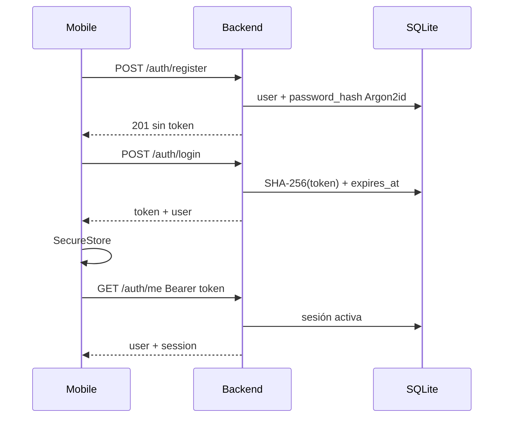

# WOD — módulo de acceso
 
WOD es una app de entrenamiento físico para profesionales. Este challenge cubre solo el **módulo de acceso**: registro, login y gestión segura de sesiones. Además, como extras opcionales: recuperación de contraseña, verificación de email, perfil, sesiones múltiples y tema claro/oscuro según el sistema.
 
```
mobile/     Expo (SDK 58) + Expo Router + TypeScript
backend/    Node 24 + Express 5 + Zod 4 + SQLite
```
 
## Inicio rápido
 
Con Node.js 24 instalado, en dos terminales:
 
```bash
# Terminal 1: backend
cd backend
cp .env.example .env
npm install
npm run dev
```
 
```bash
# Terminal 2: app
cd mobile
npm install
npx expo start
```
 
Escanear el QR con Expo Go (teléfono en la misma Wi-Fi que la PC). El detalle de cada paso, el entorno para emulador y simulador y los extras opcionales están más abajo.
 
## Stack
 
| Capa | Tecnología |
|---|---|
| Mobile | Expo 58, Expo Router, TypeScript, Zod, expo-secure-store, expo-blur, Reanimated |
| Backend | Express 5, Zod 4, better-sqlite3, @node-rs/argon2 (Argon2id), Helmet, CORS, express-rate-limit |
| Mail local (opcional) | nodemailer → Mailpit (SMTP 1025, bandeja http://localhost:8025) |
| Docs API | zod-to-openapi + swagger-ui-express en `/docs`, solo si `NODE_ENV !== 'production'` |
| Tests | Vitest + supertest (backend), Jest + RNTL (mobile) |
| CI | GitHub Actions (`.github/workflows/ci.yml`) |
 
## Arquitectura (breve)
 

 
- El registro **no** crea sesión: hay que hacer login.
- El token es opaco (32 bytes aleatorios). En la BD solo se guarda su SHA-256.
- Cada request autenticado valida que la sesión exista, no esté revocada y no haya vencido.
- Logout: primero se revoca en la BD; después se borra SecureStore y se navega con `replace`.
## Decisiones clave
 
| Tema | Decisión |
|---|---|
| Sesión | Token opaco; hash SHA-256 en BD; TTL 7 días |
| Logout | Revocar en servidor antes de limpiar el teléfono |
| Login inválido | Mensaje genérico + hash dummy (mismo costo Argon2id) |
| Email duplicado | 409 `EMAIL_TAKEN` + rate limit de registro |
| Email | Normalizado (trim + lowercase + NFKC), UNIQUE |
| Password | 12–128 caracteres, sin reglas de símbolos |
| Mails | Mailpit local (no salen a internet); códigos de 6 dígitos con hash, 15 min, 5 intentos |
| Tema | Claro/oscuro según el sistema (`userInterfaceStyle: automatic`) |
 
Detalle de amenazas, mitigaciones y riesgos aceptados: [THREAT_MODEL.md](THREAT_MODEL.md).
 
## Seguridad (resumen)
 
- Contraseñas solo como Argon2id; tokens y códigos solo como SHA-256.
- Rate limit por IP y por email (login y recuperación).
- Los logs no incluyen bodies, tokens, hashes ni códigos.
- Swagger (`/docs`, `/docs.json`) no se monta en producción.
- `.env` y `*.db` están en `.gitignore`; solo se versionan los `.env.example`.
- Los scripts de instalación de dependencias del backend están deshabilitados (`backend/.npmrc`).
- HTTP solo para desarrollo local; en producción corresponde HTTPS (ver "Mejoras para producción").
## Requisitos
 
- **Node.js ≥ 24** (ver `backend/.nvmrc`; lo probé con 24.22).
- Teléfono con Expo Go (misma Wi-Fi que la PC) o emulador/simulador.
- Opcionales: **Mailpit** (para ver los códigos de verificación y recuperación) y **Docker** (para levantar API + Mailpit con Compose).
## Instalación
 
### 1. Backend
 
```bash
cd backend
cp .env.example .env
npm install
npm run dev
```
 
Debería decir `WOD API escuchando en el puerto 3000`. Al arrancar aplica las migraciones pendientes y limpia sesiones vencidas.
 
`backend/.npmrc` pone `ignore-scripts=true` para que `npm install` / `npm ci` no dispare la compilación de `better-sqlite3` (node-gyp), que en Windows exige Visual Studio. El paquete 13.2.0 ya trae el binario en `prebuilds/` (por ejemplo `win32-x64.node`). Si en tu plataforma no hay binario, ver "Problemas conocidos".
 
Swagger (solo development): http://localhost:3000/docs
 
### 2. Mobile
 
```bash
cd mobile
npm install
npx expo start
```
 
Escanear el QR con Expo Go. Sin `mobile/.env`, la app usa la IP de Metro con el puerto 3000 (sirve para un teléfono en la misma Wi-Fi).
 
## Entorno mobile (`EXPO_PUBLIC_API_URL`)
 
Copiar `mobile/.env.example` a `mobile/.env` solo si el fallback no alcanza.
 
| Escenario | Valor |
|---|---|
| Expo Go en teléfono (misma Wi-Fi) | Sin variable: usa la IP de Metro. O forzar `http://192.168.x.x:3000` |
| Simulador iOS | `http://localhost:3000` |
| Emulador Android | `http://10.0.2.2:3000` |
 
- Las variables `EXPO_PUBLIC_*` quedan en el bundle: nunca pongas secretos ahí.
- En Windows, permitir Node en red privada o abrir el puerto 3000 si el teléfono no conecta.
- HTTP solo para desarrollo local.
## Probar el flujo sin la app
 
La BD no trae usuarios precargados: se crean por la app o por la API. Con el backend corriendo:
 
```bash
# 1. Registro (201, sin token)
curl -s -X POST localhost:3000/auth/register -H "Content-Type: application/json" \
  -d '{"firstName":"Ana","lastName":"Prueba","email":"ana@example.com","password":"correct horse battery","confirmPassword":"correct horse battery","acceptTerms":true}'
 
# 2. Login (devuelve token)
curl -s -X POST localhost:3000/auth/login -H "Content-Type: application/json" \
  -d '{"email":"ana@example.com","password":"correct horse battery"}'
 
# 3. Perfil (reemplazar TOKEN por el valor devuelto)
curl -s localhost:3000/auth/me -H "Authorization: Bearer TOKEN"
 
# 4. Logout (204) y el mismo token ya no sirve (401)
curl -i -X POST localhost:3000/auth/logout -H "Authorization: Bearer TOKEN"
curl -i localhost:3000/auth/me -H "Authorization: Bearer TOKEN"
```
 
Los datos son ficticios. También se puede probar todo desde Swagger (`/docs`) con el botón "Authorize".
 
## Base de datos
 
- Motor: **SQLite** (`better-sqlite3`).
- Archivo por defecto: `backend/data/app.db` (la carpeta se crea sola).
- Migraciones en `backend/migrations/`, aplicadas automáticamente al arrancar (o con `npm run migrate`):
  - `001_init.sql` — `users`, `sessions`
  - `002_extras.sql` — `email_verified_at`, `sessions.device` / `last_used_at`, tabla `one_time_codes`
- Fechas en epoch milisegundos. El token en claro **nunca** se guarda.
Para revisar a mano: DB Browser for SQLite. El hash de contraseña empieza con `$argon2id$`.
 
## Comandos
 
### Backend (`cd backend`)
 
| Comando | Qué hace |
|---|---|
| `npm run dev` | API con recarga (`tsx watch`) |
| `npm start` | API sin watch |
| `npm run migrate` | Solo migraciones |
| `npm run typecheck` | TypeScript |
| `npm test` | Vitest |
 
### Mobile (`cd mobile`)
 
| Comando | Qué hace |
|---|---|
| `npx expo start` | Metro + QR |
| `npm run typecheck` | TypeScript |
| `npm test` | Jest (en CI: `--runInBand`) |
 
## Tests
 
Los tests usan los IDs del enunciado (`F-01`…`F-11`, `S-01`…`S-05`). Siempre hay un caso de token revocado → 401.
 
- Backend: Vitest + supertest, BD temporal por suite.
- Mobile: Jest + React Native Testing Library; SecureStore y blur mockeados.
- CI: typecheck + tests de ambos proyectos (mobile genera typed routes con `expo start` antes del typecheck).
- Resultado en mi última corrida: backend 76/76, mobile 75/75.
 
## Plataformas probadas
 
| Plataforma | Estado |
|---|---|
| iPhone con Expo Go (misma Wi-Fi, URL por defecto) | Probado: flujo completo y extras |
| Android físico (Redmi Note 3) con Expo Go | Probado: bienvenida, registro, login y Home |
| PC con Windows y Node 24.22 | Probado: tests, Swagger y `docker compose up --build` |
| Segunda PC con Windows, sin Visual Studio | Instalación con `npm ci --ignore-scripts` y 76 tests de backend en verde; es el caso que motivó el `.npmrc` |
| Simulador iOS (`localhost`) | No probado; documentado |
| Emulador Android (`10.0.2.2`) | No probado; documentado |
 
El checklist manual completo está en [QA_CHECKLIST.md](QA_CHECKLIST.md).
 
## Extras opcionales
 
Nada de esto hace falta para el flujo obligatorio (registro, login, sesión y logout).
 
### Mailpit (códigos de email)
 
Mailpit es una bandeja SMTP local: el backend le manda los mails de **verificación de email** y **recuperación de contraseña**, y el código de 6 dígitos se lee en el navegador. Los mails **no salen a internet**.
 
| Puerto | Uso |
|---|---|
| `1025` | SMTP (el backend habla con Mailpit acá) |
| `8025` | UI de la bandeja → http://localhost:8025 |
 
El backend ya viene configurado en `backend/.env.example`:
 
```env
SMTP_HOST=localhost
SMTP_PORT=1025
MAIL_FROM=WOD <no-reply@wod.local>
```
 
Sin Mailpit, registro, login y sesión funcionan igual. El envío falla en silencio para el usuario y el backend loguea `[mail] envío fallido: …`.
 
**Opción A — Docker.** Desde la raíz del repo:
 
```bash
docker compose up mailpit
```
 
**Opción B — Binario (Windows, sin Docker).** Bajar `mailpit_*_windows_amd64.zip` de [Mailpit v1.34.0](https://github.com/axllent/mailpit/releases/tag/v1.34.0), descomprimirlo y ejecutar `mailpit.exe`. No hace falta instalarlo.
 
**Cómo comprobar que anda:** con backend y Mailpit levantados, crear una cuenta en la app (o pedir un código desde "¿Olvidaste tu contraseña?") y abrir http://localhost:8025: tiene que aparecer un mail con un código de 6 dígitos.
 
### Todo con Docker
 
```bash
docker compose up --build
```
 
API en :3000, Mailpit en :8025. La BD queda en el volumen `backend-data`. La imagen es de desarrollo (ver "Mejoras para producción").
 
## Problemas conocidos
 
**`better-sqlite3` sin binario precompilado para tu plataforma.** Con el `.npmrc` del backend, npm no compila el módulo. Si en tu SO/arquitectura no hay prebuild y la librería no carga:
 
1. Instalá Visual Studio Build Tools con la workload **Desktop development with C++** (en Linux/macOS, las herramientas de build equivalentes).
2. Reconstruí el módulo:
```bash
cd backend
npm rebuild better-sqlite3 --ignore-scripts=false
```
 
> Ese comando de rebuild **no está verificado en esta entrega** (hace falta una máquina con Visual Studio Build Tools).
 
**Otras limitaciones:**
 
- Rate limit en memoria: se resetea al reiniciar y no se comparte entre instancias.
- `trust proxy` no está configurado: detrás de un proxy el límite por IP sería global.
- No probé el simulador de iOS ni el emulador de Android; las URLs están documentadas.
- No se envían mails a casillas reales, solo a Mailpit.
## Mejoras para producción
 
| Tema | Hoy | Para producción |
|---|---|---|
| Transporte | HTTP en la LAN | HTTPS con proxy inverso (TLS) y HSTS. Android e iOS bloquean HTTP en claro en builds de producción por defecto |
| Rate limit | En memoria | Store compartido (por ejemplo Redis) y `trust proxy` según el despliegue |
| Códigos de un solo uso | SHA-256 | HMAC-SHA256 con un secreto del servidor |
| Mails | Mailpit por SMTP sin TLS | Proveedor SMTP con TLS, SPF y DKIM |
| Sesiones vencidas | Se borran al arrancar el servidor | Job periódico de limpieza |
| Docker | Imagen de desarrollo (`tsx`, `NODE_ENV=development`, Swagger visible) | Build de producción con `NODE_ENV=production` |
| Rotación de token | Si se pierde la respuesta de `/auth/rotate`, hay que volver a ingresar | Período de gracia del token anterior |
 
## QA y uso de IA
 
- Checklist manual: [QA_CHECKLIST.md](QA_CHECKLIST.md), con plataforma y resultado de cada caso.
- Declaración de uso de IA: [AI_USAGE.md](AI_USAGE.md).
- Modelo de amenazas: [THREAT_MODEL.md](THREAT_MODEL.md).
 