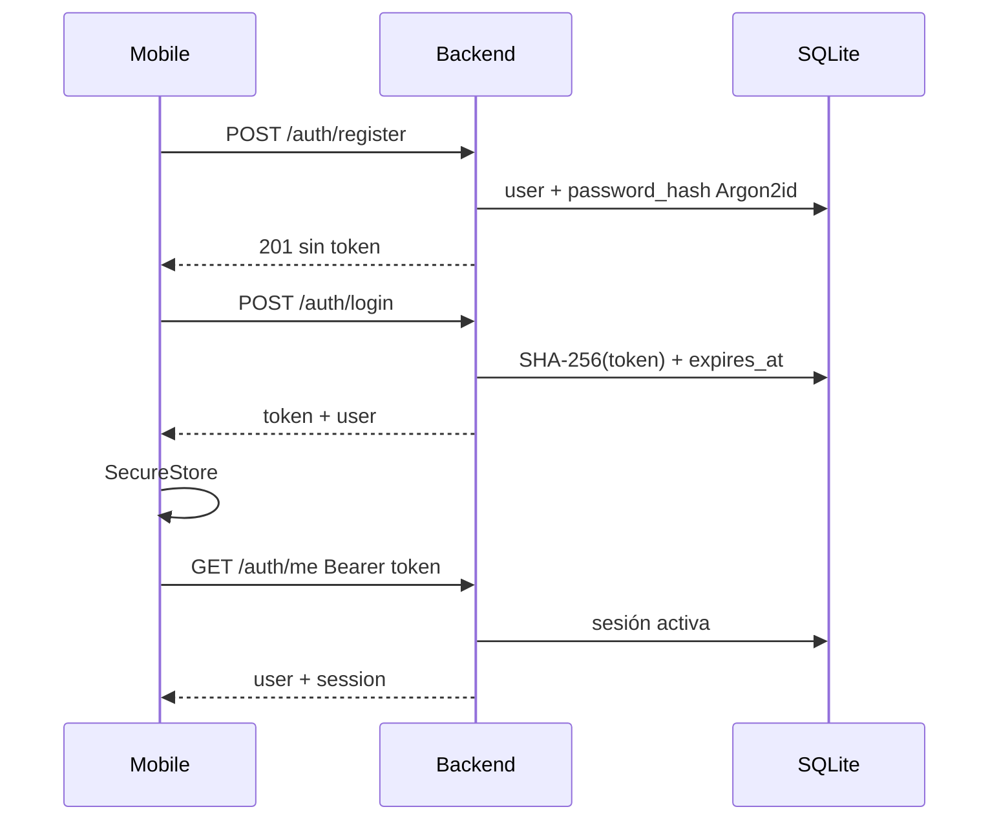

# WOD — módulo de acceso

WOD es una app de entrenamiento físico para profesionales. Este challenge cubre solo el **módulo de acceso**: registro, login y gestión segura de sesiones (más extras de la Fase 4: recuperación de contraseña, verificación de email, perfil, sesiones múltiples y tema según el sistema).

```
mobile/     Expo (SDK 58) + Expo Router + TypeScript
backend/    Node 24 + Express 5 + Zod 4 + SQLite
```

## Stack

| Capa | Tecnología |
|---|---|
| Mobile | Expo 58, Expo Router, TypeScript, Zod, expo-secure-store, expo-blur, Reanimated |
| Backend | Express 5, Zod 4, better-sqlite3, @node-rs/argon2 (Argon2id), Helmet, CORS, express-rate-limit |
| Mail local | nodemailer → Mailpit (SMTP 1025, bandeja http://localhost:8025) |
| Docs API | zod-to-openapi + swagger-ui-express en `/docs` solo si `NODE_ENV !== 'production'` |
| Tests | Vitest + supertest (backend), Jest + RNTL (mobile) |
| CI | GitHub Actions (`.github/workflows/ci.yml`) |

## Arquitectura (breve)



- El registro **no** crea sesión: hay que hacer login.
- El token es opaco (32 bytes aleatorios). En la BD solo se guarda su SHA-256.
- Cada request autenticado valida que la sesión exista, no esté revocada y no haya vencido.
- Logout: primero se revoca en la BD; después se borra SecureStore y se navega con `replace`.

## Decisiones clave

| Tema | Decisión |
|---|---|
| Sesión | Token opaco; hash SHA-256 en BD; TTL 7 días |
| Logout | Revocar en servidor antes de limpiar el teléfono |
| Login inválido | Mensaje genérico + hash dummy (mismo costo Argon2id) |
| Email duplicado | 409 `EMAIL_TAKEN` + rate limit de registro |
| Email | Normalizado (trim + lowercase + NFKC), UNIQUE |
| Password | 12–128 caracteres, sin reglas de símbolos |
| Mails | Mailpit local (no salen a internet); códigos de 6 dígitos con hash, 15 min, 5 intentos |
| Tema | Claro/oscuro según el sistema (`userInterfaceStyle: automatic`) |

Detalle de amenazas y mitigaciones: [THREAT_MODEL.md](THREAT_MODEL.md).

## Seguridad (resumen)

- Contraseñas solo como Argon2id; tokens y códigos solo como SHA-256.
- Rate limit por IP y por email (login y recuperación).
- Los logs no incluyen bodies, tokens, hashes ni códigos.
- Swagger (`/docs`, `/docs.json`) no se monta en producción.
- `.env` y `*.db` están en `.gitignore`; solo se versionan los `.env.example`.
- HTTP solo para desarrollo local.

## Requisitos

- **Node.js ≥ 24** (ver `backend/.nvmrc`).
- Teléfono con Expo Go (misma Wi-Fi que la PC) o emulador/simulador.
- **Mailpit** (opcional): hace falta para ver los códigos de verificación y de recuperación. Sin Mailpit el resto de la app funciona; el backend loguea `[mail] envío fallido: …`.
- Docker (opcional): para levantar API + Mailpit con Compose.

## Instalación

### 1. Backend

```bash
cd backend
cp .env.example .env
npm install
npm run dev
```

Debería decir `WOD API escuchando en el puerto 3000`. Al arrancar aplica las migraciones pendientes y limpia sesiones vencidas.

> **npm 11 y scripts de instalación:** si `npm install` / `npm ci` falla al compilar `better-sqlite3` (node-gyp), usá `npm ci --ignore-scripts`. El paquete 13.2.0 trae el binario precompilado (`prebuilds/win32-x64.node`, etc.) y no hace falta compilar. Lo mismo aplica a `esbuild` / `tsx` en el backend.

Swagger (solo development): http://localhost:3000/docs

### 2. Mobile

```bash
cd mobile
npm install
npx expo start
```

Escanear el QR con Expo Go. Sin `mobile/.env`, la app usa la IP de Metro con el puerto 3000 (sirve para un teléfono en la misma Wi-Fi).

### 3. Mailpit (códigos de email)

Mailpit es una bandeja SMTP local: el backend le manda los mails de **verificación de email** y **recuperación de contraseña**, y vos leés el código de 6 dígitos en el navegador. Los mails **no salen a internet**.

| Puerto | Uso |
|---|---|
| `1025` | SMTP (el backend habla con Mailpit acá) |
| `8025` | UI de la bandeja → http://localhost:8025 |

El backend ya viene configurado en `backend/.env.example`:

```env
SMTP_HOST=localhost
SMTP_PORT=1025
MAIL_FROM=WOD <no-reply@wod.local>
```

Sin Mailpit el resto de la app funciona (registro, login, sesión). El envío falla en silencio para el usuario y el backend loguea `[mail] envío fallido: …`; no vas a poder ver el código.

#### Opción A — Docker (recomendada si tenés Docker)

Desde la **raíz del repo**:

```bash
docker compose up mailpit
```

Dejá esa terminal abierta. Abrí http://localhost:8025: debería verse la bandeja vacía.

Para parar: `Ctrl+C`, o en otra terminal `docker compose stop mailpit`.

#### Opción B — Binario (Windows, sin Docker)

1. Bajá **Mailpit v1.34.0** para Windows: [releases](https://github.com/axllent/mailpit/releases/tag/v1.34.0) → archivo `mailpit_*_windows_amd64.zip` (o `arm64` si aplica).
2. Descomprimí el ZIP; adentro está `mailpit.exe`.
3. En una terminal, desde esa carpeta:

```bash
./mailpit.exe
```

(o `mailpit.exe` en PowerShell/CMD). Por defecto escucha SMTP en `1025` y la UI en `8025`.

4. Abrí http://localhost:8025.

No hace falta instalarlo en el PATH: alcanza con ejecutarlo mientras desarrollás.

#### Cómo comprobar que anda

1. Backend y Mailpit levantados.
2. En la app: crear una cuenta e ingresar, **o** Login → “¿Olvidaste tu contraseña?” → pedir código.
3. En http://localhost:8025 debería aparecer un mail (`WOD: verificá tu email` o el de recuperación) con un código de 6 dígitos.
4. Ese código se usa en la pantalla correspondiente de la app.

### 4. Todo con Docker (opcional)

```bash
docker compose up --build
```

API en :3000, Mailpit en :8025. La BD queda en el volumen `backend-data`.

## Entorno mobile (`EXPO_PUBLIC_API_URL`)

Copiar `mobile/.env.example` a `mobile/.env` solo si el fallback no alcanza.

| Escenario | Valor |
|---|---|
| Expo Go en teléfono (misma Wi-Fi) | Sin variable: usa la IP de Metro. O forzar `http://192.168.x.x:3000` |
| Simulador iOS | `http://localhost:3000` |
| Emulador Android | `http://10.0.2.2:3000` |

- Las variables `EXPO_PUBLIC_*` quedan en el bundle: nunca pongas secretos ahí.
- En Windows, permitir Node en red privada / abrir el puerto 3000 si el teléfono no conecta.
- HTTP solo para desarrollo local.

## Base de datos

- Motor: **SQLite** (`better-sqlite3`).
- Archivo por defecto: `backend/data/app.db` (la carpeta se crea sola).
- Migraciones en `backend/migrations/`:
  - `001_init.sql` — `users`, `sessions`
  - `002_extras.sql` — `email_verified_at`, `sessions.device` / `last_used_at`, tabla `one_time_codes`
- Fechas en epoch milisegundos. El token en claro **nunca** se guarda.

Para revisar a mano: DB Browser for SQLite. El hash de contraseña empieza con `$argon2id$`.

## Comandos

### Backend (`cd backend`)

| Comando | Qué hace |
|---|---|
| `npm run dev` | API con recarga (`tsx watch`) |
| `npm start` | API sin watch |
| `npm run migrate` | Solo migraciones |
| `npm run typecheck` | TypeScript |
| `npm test` | Vitest |

### Mobile (`cd mobile`)

| Comando | Qué hace |
|---|---|
| `npx expo start` | Metro + QR |
| `npm run typecheck` | TypeScript |
| `npm test` | Jest (en CI: `--runInBand`) |

## Tests

Los tests usan los IDs del enunciado (`F-01`…`F-11`, `S-01`…`S-05`). Siempre hay un caso de token revocado → 401.

- Backend: Vitest + supertest, BD temporal por suite.
- Mobile: Jest + React Native Testing Library; SecureStore y blur mockeados.
- CI: typecheck + tests de ambos proyectos (mobile genera typed routes con `expo start` antes del typecheck).

## Checklist de QA y uso de IA

- Checklist manual: [QA_CHECKLIST.md](QA_CHECKLIST.md) (Fase 2 verificada en iPhone con Expo Go; Fases 3–4 pendientes de marcar).
- Declaración de uso de IA: [AI_USAGE.md](AI_USAGE.md).
- Modelo de amenazas: [THREAT_MODEL.md](THREAT_MODEL.md).
